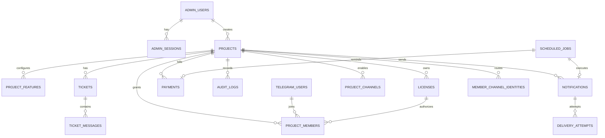

# Data model

PostgreSQL 16. All primary keys are UUIDv4 (`uuid`), all timestamps are
`timestamptz` (UTC in storage, Tehran in the UI), all amounts are integers.
Schema changes are applied only through Alembic migrations.

## 1. Entity relationships

Notes:

- `LICENSES.project_id` is `ON DELETE CASCADE`; a partial unique index guarantees **at
  most one live license** (`pending` or `active`) per project.
- `PROJECT_MEMBERS.license_id` is `ON DELETE SET NULL`: deleting a license row does not
  delete membership history, but access checks require a live license anyway.
- `DELIVERY_ATTEMPTS` has `UNIQUE(notification_id, attempt_no, channel, recipient)`.
- `SCHEDULED_JOBS.dedupe_key` is unique (nullable). Enqueueing uses
  `INSERT … ON CONFLICT (dedupe_key) DO NOTHING`.
- `AUDIT_LOGS.project_id` is `ON DELETE SET NULL`, so deleting a project (demo cleanup or
  an explicit admin action) keeps the audit history; there is no update/delete API for
  audit rows.
- `TICKETS` cascade with their project and `TICKET_MESSAGES` with their ticket;
  `TELEGRAM_CONVERSATIONS` are keyed by user + project and expire automatically.

## 2. Tables

### `admin_users`

| Column | Type | Constraints |
| --- | --- | --- |
| `id` | uuid | PK |
| `email` | varchar(255) | unique, not null |
| `password_hash` | varchar(255) | not null, Argon2id |
| `display_name` | varchar(120) | not null |
| `is_active` | boolean | not null, default true |
| `last_login_at` | timestamptz | nullable |
| `last_password_change_at` | timestamptz | nullable; set on create, change and reset |
| `created_by` | uuid | FK → `admin_users.id` `ON DELETE SET NULL` |
| `created_at`, `updated_at` | timestamptz | not null |

The first admin is created once from `BOOTSTRAP_ADMIN_*` when the table is empty. Further
admins are created by an authenticated admin. There is no public signup. Password changes
revoke every other session of that admin; resetting another admin's password generates a
one-time temporary password returned exactly once and revokes all of that admin's
sessions. The last active admin cannot be deactivated, and nobody can deactivate
themselves.

### `admin_sessions`

| Column | Type | Constraints |
| --- | --- | --- |
| `id` | uuid | PK |
| `admin_id` | uuid | FK → `admin_users.id` `ON DELETE CASCADE`, indexed |
| `token_hash` | varchar(64) | unique, not null (SHA-256 of the cookie token) |
| `csrf_token` | varchar(64) | not null |
| `user_agent` | varchar(300) | nullable |
| `ip_address` | varchar(64) | nullable |
| `expires_at` | timestamptz | not null, indexed |
| `revoked_at` | timestamptz | nullable |

Expired or revoked sessions are rejected and deleted lazily.

### `projects`

| Column | Type | Constraints |
| --- | --- | --- |
| `id` | uuid | PK |
| `name` | varchar(160) | not null |
| `slug` | varchar(80) | unique, not null |
| `client_name` | varchar(160) | not null |
| `description` | text | nullable |
| `status` | varchar(20) | `active`/`inactive` check |
| `is_demo` | boolean | not null, default false |
| `telegram_connected_at` | timestamptz | nullable |
| `archived_at` | timestamptz | nullable; archived projects are hidden from the default list |
| `created_at`, `updated_at` | timestamptz | not null |

`is_demo` marks seed/demo rows. They are labelled «نمایشی» in the UI, must never be used
for operational reporting, and can be deleted safely (`POST /projects/demo-purge` or
`python -m scripts.purge_demo --yes`).

Archiving is not deletion: history stays, but the bot, queued sends and reminders stop
and the status becomes `inactive`. Permanent deletion is a separate, confirmed action;
`audit_logs.project_id` is `ON DELETE SET NULL`, so the audit trail survives it.

### `project_features`

| Column | Type | Constraints |
| --- | --- | --- |
| `id` | uuid | PK |
| `project_id` | uuid | FK → `projects` `CASCADE`, indexed |
| `key` | varchar(60) | not null, feature registry key |
| `enabled` | boolean | not null, default true |
| `settings` | jsonb | not null, default `{}`; owned by the capability plugin |

`UNIQUE(project_id, key)`. Missing rows fall back to the registry default. Because `key`
is a string and `settings` is JSONB, a new plugin needs no migration.

### `project_channels`

| Column | Type | Constraints |
| --- | --- | --- |
| `id` | uuid | PK |
| `project_id` | uuid | FK → `projects` `CASCADE` |
| `channel` | varchar(20) | `telegram`/`bale`/`eitaa`/`smsir` |
| `enabled` | boolean | not null, default false |
| `settings` | jsonb | not null, default `{}`; whitelisted presentation hints only |
| `created_at`, `updated_at` | timestamptz | not null |

Unique `(project_id, channel)`. Credentials never live here; providers are configured
centrally through environment variables.

### `member_channel_identities`

| Column | Type | Constraints |
| --- | --- | --- |
| `id` | uuid | PK |
| `project_id` | uuid | FK → `projects` `CASCADE` |
| `project_member_id` | uuid | FK → `project_members` `CASCADE` |
| `channel` | varchar(20) | `bale`/`eitaa`/`smsir` |
| `external_id` | varchar(120) | chat id or `09xxxxxxxxx`; length ≥ 3 |
| `label` | varchar(120) | nullable |

Unique `(project_member_id, channel)` and `(channel, external_id)`. Telegram identity stays
in `telegram_users`; this table only adds destinations for other providers.

### `tickets`, `ticket_messages`, `telegram_conversations`

- `tickets`: `project_id` (FK cascade), optional `member_id`, `subject`,
  `status` (`open|pending_admin|pending_employer|closed`), `priority`
  (`low|normal|high`), `created_by_type`, `admin_unread`, `member_unread`,
  `last_message_at` (indexed), `closed_at`.
- `ticket_messages`: `ticket_id` (cascade), `author_type` (`admin|employer|system`),
  optional `author_admin_id`/`author_member_id` (SET NULL), `author_label` (display
  snapshot), `body`, `channel` (`web|telegram`), `created_at`. Index on
  `(ticket_id, created_at)`.
- `telegram_conversations`: pending multi-step input keyed by
  `(telegram_user_id, project_id)`, with `step`, JSONB `payload`, `expires_at` and
  `completed`. This keeps ticket ids out of callback data and expires stale flows.

### `licenses`

| Column | Type | Constraints |
| --- | --- | --- |
| `id` | uuid | PK |
| `project_id` | uuid | FK → projects, `ON DELETE CASCADE` |
| `code_hash` | varchar(64) | unique, not null, indexed |
| `code_prefix` | varchar(8) | not null |
| `status` | varchar(20) | `pending`/`active`/`revoked`/`expired` |
| `expires_at`, `activated_at`, `revoked_at` | timestamptz | nullable |
| `issued_by` | uuid | FK → admin_users `ON DELETE SET NULL` |
| `created_at`, `updated_at` | timestamptz | not null |

Indexes:

- `uq_licenses_live_project` — unique partial index on `project_id` where
  `status IN ('pending','active')`.
- `ix_licenses_project_created` — `(project_id, created_at)`.

License code format: `NN-XXXX-XXXX-XXXX-XXXX`, Crockford-ish alphabet without
`O/0/I/1/L`. `code_hash = HMAC-SHA256(SECRET_KEY, normalized_code)` (hex, 64 chars).
The raw code is returned only from the issuing response. Expiry is evaluated lazily and
persisted as `expired` by the service layer; the **effective** status is computed for
serialization.

### `telegram_users`

| Column | Type | Constraints |
| --- | --- | --- |
| `id` | uuid | PK |
| `telegram_id` | bigint | unique, not null, indexed |
| `username`, `first_name`, `last_name` | varchar | nullable |
| `created_at`, `updated_at` | timestamptz | not null |

`telegram_id` is the only identity used for delivery; usernames are informational and
may be absent.

### `project_members`

| Column | Type | Constraints |
| --- | --- | --- |
| `id` | uuid | PK |
| `project_id` | uuid | FK → projects, cascade |
| `telegram_user_id` | uuid | FK → telegram_users, cascade |
| `license_id` | uuid | FK → licenses, `ON DELETE SET NULL` |
| `role` | varchar(20) | `owner`/`member` |
| `status` | varchar(24) | `pending_approval`/`active`/`revoked` |
| `activated_at`, `revoked_at` | timestamptz | nullable |
| `created_at`, `updated_at` | timestamptz | not null |

Indexes: `UNIQUE(project_id, telegram_user_id)`, `(project_id, status)`.

The data model supports multiple members per project. The v1 flow assigns one `owner`
and the UI treats the first active member as the employer.

### `notifications`

| Column | Type | Constraints |
| --- | --- | --- |
| `id` | uuid | PK |
| `project_id` | uuid | FK → projects, cascade |
| `type` | varchar(20) | `announcement`/`financial`/`system` |
| `title` | varchar(200) | not null |
| `body` | text | not null |
| `status` | varchar(20) | see lifecycle below |
| `scheduled_at`, `queued_at`, `sent_at`, `cancelled_at` | timestamptz | nullable |
| `attempt_count` | integer | not null, default 0 |
| `last_error` | varchar(1000) | nullable |
| `channels` | jsonb | requested providers, default `["telegram"]` |
| `telegram_message_id` | bigint | nullable |
| `send_job_id` | uuid | FK → scheduled_jobs, `ON DELETE SET NULL` |
| `created_by` | uuid | FK → admin_users, `ON DELETE SET NULL` |
| `created_at`, `updated_at` | timestamptz | not null |

Also stores `scheduled` info only as `scheduled_at`; the queue holds the actual run time.

Lifecycle: `draft → queued → sending → sent | failed | retry_wait → queued …`, plus
`cancelled`. `unknown` is a **delivery** state, not a notification state: a notification
whose delivery result is unknown stays `failed` and is never marked `sent`.

### `delivery_attempts`

| Column | Type | Constraints |
| --- | --- | --- |
| `id` | uuid | PK |
| `notification_id` | uuid | FK → notifications, cascade |
| `chat_id` | bigint | nullable (Telegram-compatible providers) |
| `recipient` | varchar(120) | not null; chat id or phone number |
| `channel` | varchar(20) | not null, default `telegram` |
| `attempt_no` | integer | not null |
| `status` | varchar(16) | `pending`/`sending`/`sent`/`failed`/`unknown` |
| `telegram_message_id` | bigint | nullable |
| `error` | varchar(1000) | nullable |
| `is_mock` | boolean | not null |
| `started_at`, `finished_at` | timestamptz | |

`UNIQUE(notification_id, attempt_no, channel, recipient)`; `(notification_id)` indexed.
The unique key includes the channel and destination so one notification can fan out to
several providers in the same attempt without collisions.

### `payments`

| Column | Type | Constraints |
| --- | --- | --- |
| `id` | uuid | PK |
| `project_id` | uuid | FK → projects, cascade |
| `title` | varchar(200) | not null |
| `amount_minor` | bigint | `> 0` |
| `currency` | varchar(3) | `IRR`/`IRT`/`USD`/`EUR` |
| `due_at` | timestamptz | not null |
| `status` | varchar(16) | `unpaid`/`paid`/`cancelled` |
| `notes` | text | nullable |
| `paid_at`, `cancelled_at` | timestamptz | nullable |
| `reminder_job_id` | uuid | FK → scheduled_jobs, `ON DELETE SET NULL` |
| `created_by` | uuid | FK → admin_users, `ON DELETE SET NULL` |
| `created_at`, `updated_at` | timestamptz | not null |

Indexes: `(project_id, due_at)`, `(status, due_at)`.

`is_overdue` is **derived** (`status = 'unpaid' and due_at < now`) and never stored.
There is no bank reference/receipt column: this is a record-and-notify system.

### `scheduled_jobs`

| Column | Type | Constraints |
| --- | --- | --- |
| `id` | uuid | PK |
| `kind` | varchar(40) | `notification_send`/`payment_reminder`/`activation_approved` |
| `payload` | jsonb | not null |
| `status` | varchar(16) | `pending`/`processing`/`done`/`failed`/`cancelled` |
| `run_at` | timestamptz | not null, indexed |
| `attempts`, `max_attempts` | integer | not null |
| `locked_at`, `locked_by` | timestamptz/varchar | nullable |
| `last_error` | text | nullable |
| `dedupe_key` | varchar(160) | unique, nullable |
| `finished_at` | timestamptz | nullable |
| `created_at`, `updated_at` | timestamptz | not null |

Indexes: `(status, run_at)`, `(kind)`. Claims use `FOR UPDATE SKIP LOCKED`; completion
and retry are written in the same transaction as the job's side effects where possible.

### `audit_logs`

| Column | Type | Constraints |
| --- | --- | --- |
| `id` | uuid | PK |
| `actor_type` | varchar(20) | `admin`/`telegram_user`/`system` |
| `actor_id` | uuid | nullable (no FK: history survives actor deletion) |
| `actor_label` | varchar(160) | nullable |
| `action` | varchar(80) | not null |
| `entity_type` | varchar(40) | not null |
| `entity_id` | uuid | nullable |
| `project_id` | uuid | FK → projects, cascade, nullable |
| `context` | jsonb | not null |
| `created_at` | timestamptz | not null |

Indexes: `(project_id, created_at)`, `(entity_type, entity_id)`.

Context is a small JSON object with safe metadata only. It never stores raw license
codes, passwords, session tokens, CSRF tokens or bot tokens.

### `telegram_updates`

| Column | Type | Constraints |
| --- | --- | --- |
| `id` | uuid | PK |
| `update_id` | bigint | unique, not null, indexed |
| `received_at` | timestamptz | not null |
| `processed` | boolean | not null |
| `error` | varchar(500) | nullable |

Idempotency ledger for the webhook.

### `system_state`

| Column | Type | Constraints |
| --- | --- | --- |
| `key` | varchar(80) | PK |
| `value` | jsonb | not null |
| `updated_at` | timestamptz | not null |

Keys: `worker_heartbeat` (`{hostname, started_at, last_seen_at}`), `telegram_last_update_at`.

## 3. Invariants

1. A project has at most one live license; issuing revokes the previous one.
2. A Telegram user appears at most once per project.
3. A member has `active` status only together with a live license and an active project;
   this is re-checked at request time, not trusted from storage.
4. Every notification transition is written with the corresponding audit entry.
5. `dedupe_key` prevents duplicate queue entries for the same logical event.
6. Delivered attempts are immutable; retries create new attempt rows.
7. Demo rows (`is_demo`) are excluded from operational conclusions and clearly labelled.

## 4. Migrations

- Location: `apps/api/alembic/versions/`.
- Apply: `cd apps/api && alembic upgrade head`.
- Check for drift in development: `alembic check`.
- Never edit an applied migration; add a new revision.
- The initial revision is `a182707c5525_initial_schema.py`.
- CI applies migrations from an empty database before running tests, proving the
  migration chain works.

## 5. Retention and maintenance

- `admin_sessions`: expired rows can be pruned periodically
  (`DELETE FROM admin_sessions WHERE expires_at < now() - interval '30 days'`).
- `scheduled_jobs`: completed jobs may be archived after 30–90 days; keep failed jobs
  longer for diagnosis.
- `delivery_attempts`, `notifications`, `payments`, `audit_logs`: retain per business
  policy; payments and audit logs are financial/compliance records — do not delete
  without an explicit retention decision.
- `telegram_updates`: safe to prune after a few days; it only serves webhook retries.

No destructive maintenance job is included by default.
